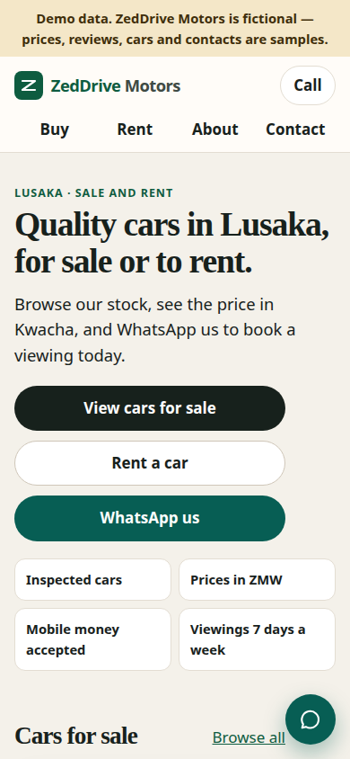
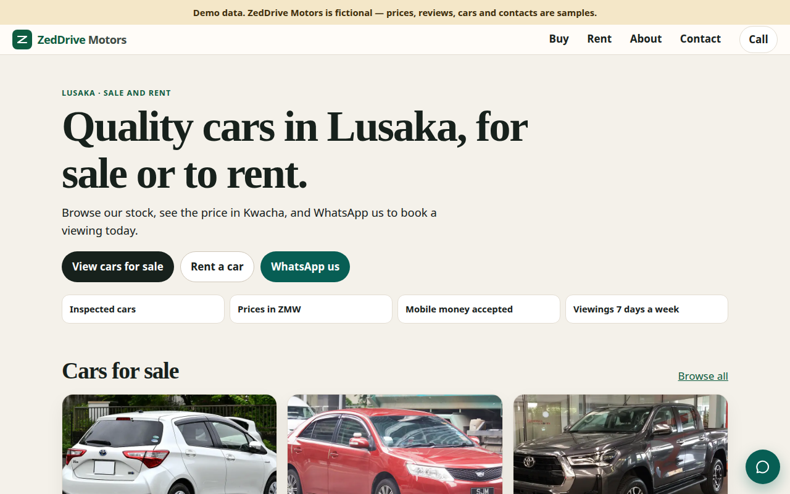
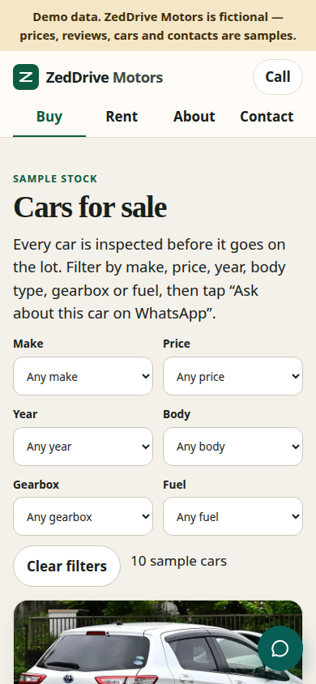
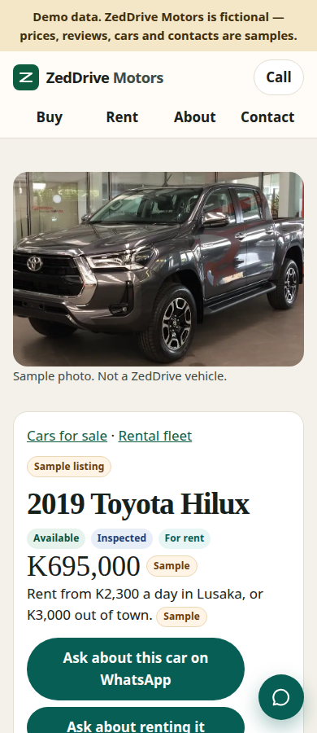
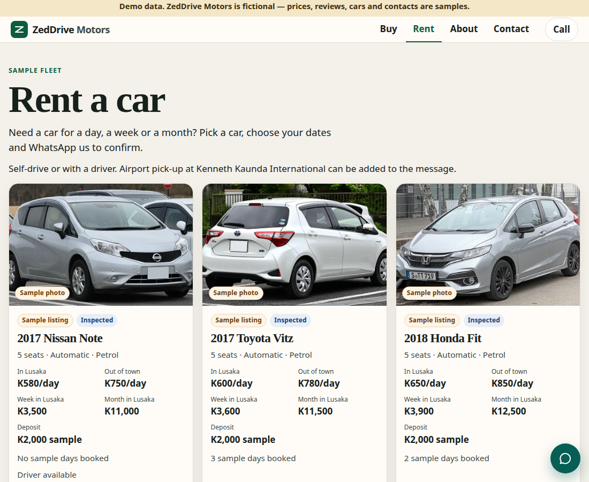
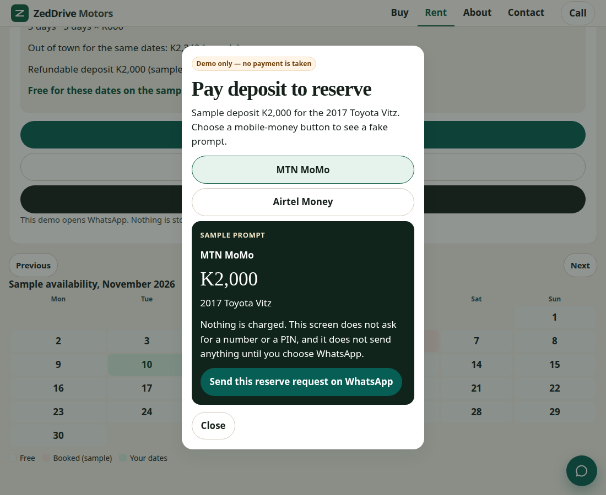

# ZedDrive Motors

A mobile-first demo website for a fictional Lusaka car dealer that sells and rents cars. It is a portfolio piece to show local dealers what a fast, WhatsApp-first site can look like.

**ZedDrive Motors is fictional.** Every car, price, review, opening hour, contact and address on the site is sample demo data. Nothing here is a real listing, a real phone number, or a real street address. The address shown is Plot 0000, Sample Road, Lusaka, Zambia (demo address).

The tagline is “Buy or rent your next car, one WhatsApp away.”

## Screenshots

Home, on a phone:



Home, on a wider screen:



Cars for sale, with filters:



A car page (sample Hilux, price and WhatsApp button):



Rental fleet, with daily rates in and out of Lusaka:



The deposit step is a demo screen. It does not take payment:



## Pages

- **Home** — headline, three actions (view cars for sale, rent a car, WhatsApp), trust points, sample reviews.
- **Buy** — sale cars only, with filters for make, price (ZMW), year, body type, gearbox and fuel. Cards show a photo, mileage, gearbox, fuel, a Kwacha price, an Inspected badge, an Available / Reserved / Sold badge, and “Ask about this car on WhatsApp”. Trade-ins and financing partners are mentioned.
- **Car** — gallery, specs, condition notes, a sample inspection checklist, and call / WhatsApp buttons. The WhatsApp text includes the car name and the sample price. Cars that are also for rent get a date picker on the same page.
- **Rent** — the same stock, limited to cars marked for rent. Each car has daily, weekly and monthly rates, split into in Lusaka and out of town. Pick dates to see the total, the refundable deposit, and a sample availability calendar. Self-drive or driver, and Kenneth Kaunda International pick-up, are included in the WhatsApp message. “Pay deposit to reserve” opens a fake MTN MoMo / Airtel Money prompt and then WhatsApp. No payment is taken and nothing is stored.
- **About** — who the fictional dealer is, a sample PACRA number (`0000000000`), placeholder yard and team images, and photo credits.
- **Contact** — Plot 0000, Sample Road, Lusaka, Zambia (demo address), opening hours, a map placeholder (no live pin), call and WhatsApp, and a short form (Buy / Rent / Trade-in) that opens WhatsApp.

A floating WhatsApp button sits on every page. Visible phone text is `+260 9XX XXX XXX`. The `tel:` and `wa.me` links use the placeholder number `260970000000`, marked in the HTML and in `src/js/config.js`.

## Run it locally

```bash
npm install
npm run dev
```

The dev server uses the GitHub Pages base path, so open:

`http://localhost:5173/lusaka-car-rental-sales/`

Build and preview the production files:

```bash
npm run build
npm run preview
```

Preview serves `dist` at `http://localhost:4173/lusaka-car-rental-sales/`.

`npm test` checks the rental price maths (daily, weekly and monthly blocks, and booked dates).

## Edit the stock

Buy and Rent both read one file:

`public/data/stock.json`

A car can be for sale, for rent, or both. Set `forSale` and `forRent`. Use `null` for the side that does not apply.

```json
{
  "id": "toyota-vitz-2017",
  "make": "Toyota",
  "model": "Vitz",
  "year": 2017,
  "mileageKm": 92400,
  "gearbox": "Automatic",
  "fuel": "Petrol",
  "bodyType": "Hatchback",
  "seats": 5,
  "colour": "White",
  "engine": "1.3L",
  "drive": "Front-wheel drive",
  "images": ["images/cars/toyota-vitz.webp"],
  "forSale": true,
  "forRent": true,
  "homeSale": true,
  "homeRent": false,
  "inspected": true,
  "conditionNotes": "Sample note shown on the car page.",
  "inspectionNotes": {
    "tyres": "Front tyres are part-worn. Sample note."
  },
  "sale": {
    "priceZmw": 96000,
    "status": "available"
  },
  "rent": {
    "dailyInLusakaZmw": 600,
    "dailyOutOfTownZmw": 780,
    "weeklyInLusakaZmw": 3600,
    "weeklyOutOfTownZmw": 4700,
    "monthlyInLusakaZmw": 11500,
    "monthlyOutOfTownZmw": 15000,
    "depositZmw": 2000,
    "withDriver": false,
    "unavailableDates": ["2026-11-04", "2026-11-05"]
  }
}
```

| Field | What it does |
| --- | --- |
| `id` | Used in the car page URL: `car.html?id=…` |
| `make`, `model`, `year` | Name on the card |
| `mileageKm` | Shown in kilometres |
| `gearbox` | `Automatic` or `Manual`. Also a sale filter |
| `fuel` | `Petrol` or `Diesel`. Also a sale filter |
| `bodyType` | `Hatchback`, `Sedan`, `SUV`, `Pickup` or `Van`. Also a sale filter |
| `seats`, `colour`, `engine`, `drive` | Specs on the car page |
| `images` | Paths inside `public/`, for example `images/cars/toyota-vitz.webp` |
| `forSale` / `forRent` | Which modes include the car |
| `homeSale` / `homeRent` | Also show it on the home page |
| `inspected` | Shows the Inspected badge |
| `badge` | Optional sample label on the card, such as `Best seller` or `Promo` |
| `conditionNotes` | Short note under the specs |
| `inspectionNotes` | Optional notes on the checklist. Keys: `engine`, `gearbox`, `brakes`, `tyres`, `suspension`, `lights`, `body`, `interior`, `warnings`, `papers`. A key with text is shown as “Note”. Other rows show “Pass” |
| `sale.priceZmw` | Sale price in Kwacha. The page labels it Sample |
| `sale.status` | `available`, `reserved` or `sold` |
| `rent.dailyInLusakaZmw` | One-day price inside Lusaka |
| `rent.dailyOutOfTownZmw` | One-day price outside Lusaka |
| `rent.weeklyInLusakaZmw` / `weeklyOutOfTownZmw` | Used for each full 7 days |
| `rent.monthlyInLusakaZmw` / `monthlyOutOfTownZmw` | Used for each full 30 days |
| `rent.depositZmw` | Refundable deposit. Sample amounts in this file are K2,000 (hatchback or sedan) and K5,000 (SUV, pickup or van) |
| `rent.withDriver` | Shows “Driver available” when true |
| `rent.unavailableDates` | Booked days as `YYYY-MM-DD`. Pick-up and return are both rental days, so a listed date blocks that day |

The quote uses monthly blocks first (30 days or more), then weekly blocks (7 days or more), then leftover days at the daily rate. In Lusaka and out of town are priced separately, and the page shows both totals.

Prices on the site are labelled **Sample**. Keep any new prices obviously fictional, and do not add prices for web-design work.

The visible phone number is written as `+260 9XX XXX XXX`. Links use a fake number, `260970000000`, called out as a placeholder in `src/js/config.js` and in the HTML. Do not replace it with a real person’s number in this public demo.

Wording that is not in the stock file (the headline, rental terms, footer) lives in the HTML pages and in `src/partials/`.

## Image credits

Photos are from Wikimedia Commons, downloaded, resized and saved as WebP in `public/images/`. They are sample photos of the models, not ZedDrive vehicles. Adapted files stay under the same licence as the original. The team picture is an original SVG for this demo.

Full credit lines are also rendered on the About page. `public/data/image-credits.json` is the list.

| File | Source | Author | Licence |
| --- | --- | --- | --- |
| `images/cars/toyota-vitz.webp` | [2017–2020 Toyota Vitz Hybrid F rear](https://commons.wikimedia.org/wiki/File:2017-2020_Toyota_Vitz_Hybrid_F_rear.jpg) | TTTNIS | CC0 1.0 |
| `images/cars/honda-fit.webp` | [Honda Jazz (3rd generation) facelift](https://commons.wikimedia.org/wiki/File:Honda_Jazz_(3rd_generation)_Facelift_1X7A1803.jpg) | Alexander-93 | CC BY-SA 4.0. The Jazz is the same model known in Lusaka as the Fit |
| `images/cars/mazda-demio.webp` | [2015–2019 Mazda Demio S](https://commons.wikimedia.org/wiki/File:2015-2019_Mazda_Demio_S.jpg) | TTTNIS | CC0 1.0 |
| `images/cars/nissan-note.webp` | [2014–2016 Nissan Note X](https://commons.wikimedia.org/wiki/File:2014-2016_Nissan_Note_X.jpg) | TTTNIS | CC0 1.0 |
| `images/cars/toyota-allion.webp` | [2008 Toyota Allion front](https://commons.wikimedia.org/wiki/File:2008_Toyota_Allion_front.jpg) | LuvsMG481 | CC BY-SA 4.0 |
| `images/cars/toyota-premio.webp` | [Toyota Premio 2.0G front](https://commons.wikimedia.org/wiki/File:Toyota_PREMIO_2.0G_2WD_(ZRT261)_front.JPG) | Tokumeigakarinoaoshima | CC0 1.0 |
| `images/cars/toyota-axio.webp` | [Silver Toyota Corolla Axio front](https://commons.wikimedia.org/wiki/File:Silver_Toyota_Corolla_Axio_Front_(SSP,_HK).jpg) | Corsadent56709 | CC BY-SA 4.0 |
| `images/cars/toyota-mark-x.webp` | [Toyota Mark X 250G front](https://commons.wikimedia.org/wiki/File:Toyota_MARK_X_250G_(GRX130)_front_(cropped).JPG) | Tokumeigakarinoaoshima | CC0 1.0 |
| `images/cars/toyota-vanguard.webp` | [Toyota Vanguard](https://commons.wikimedia.org/wiki/File:Toyota_Vanguard.JPG) | 韋駄天狗 | CC BY-SA 3.0 |
| `images/cars/toyota-harrier.webp` | [2015 Toyota Harrier Premium](https://commons.wikimedia.org/wiki/File:2015_Toyota_Harrier_Premium_2WD_2.0_DBA-ZSU60W_(190316).jpg) | オーバードライブ83 | CC BY-SA 4.0. Also used as the home hero photo |
| `images/cars/toyota-fortuner.webp` | [Toyota Fortuner, Cape Town](https://commons.wikimedia.org/wiki/File:Toyota_Fortuner,_Cape_Town_(P1060077).jpg) | Matti Blume | CC BY-SA 4.0 |
| `images/cars/toyota-hilux.webp` | [2021 Toyota Hilux Revo double-cab](https://commons.wikimedia.org/wiki/File:2021_Toyota_Hilux_Revo_Prerunner_Double-Cab_2.4_Mid.jpg) | Chanokchon | CC BY-SA 4.0 |
| `images/cars/ford-ranger.webp` | [Ford Ranger Wildtrak](https://commons.wikimedia.org/wiki/File:Ford_Ranger_(T6,_P703)_Wildtrak_IMG_7320.jpg) | Alexander-93 | CC BY-SA 4.0 |
| `images/cars/toyota-alphard.webp` | [Toyota Alphard, Johor Bahru](https://commons.wikimedia.org/wiki/File:Toyota_Alphard,_Johor_Bahru_(P1110139).jpg) | Matti Blume | CC BY-SA 4.0 |
| `images/yard/forecourt.webp` | [Dealership forecourt, Bury](https://commons.wikimedia.org/wiki/File:Forecourt_of_Car_Dealership_-_Bury_-_geograph.org.uk_-_2267284.jpg) | Anthony Parkes | CC BY-SA 2.0. Not the ZedDrive yard |
| `images/yard/team-sample.svg` | Original illustration in this repo | ZedDrive Motors demo | MIT, same as this repository. Not a photo of a real team |

CC BY-SA licences: [4.0](https://creativecommons.org/licenses/by-sa/4.0/), [3.0](https://creativecommons.org/licenses/by-sa/3.0/), [2.0](https://creativecommons.org/licenses/by-sa/2.0/). CC0: [1.0](https://creativecommons.org/publicdomain/zero/1.0/).

## Deploy

Pushes to `main` run `.github/workflows/deploy.yml`. The workflow builds the site and deploys `dist` to GitHub Pages with `actions/configure-pages`, `actions/upload-pages-artifact` and `actions/deploy-pages`.

Vite is configured with `base: '/lusaka-car-rental-sales/'` so asset and page links work on project Pages.

## Licence

[MIT](LICENSE). Copyright (c) 2026 Dennis Kabaso.
